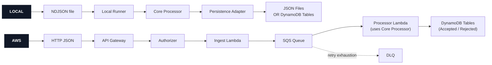

# Drone Fleet Telemetry Pipeline


An AWS Serverless pipeline for ingesting, validating, transforming and storing autonomous drone telemetry.

This project demonstrates event-driven design, robust validation, cloud-native infrastructure and reviewer-friendly local execution.

### ℹ️ Overview

The service processes telemetry events such as:

- Battery Status
- Sensor Readings
- Route Adjustments
- Delivery Completions
- Errors

Core behaviours:

- Ingest raw drone telemetry (JSON)
- Parse and validate each record independently
- Persist valid records after transforming them into a storage-friendly model
- Persist invalid records separately with structured rejection reasons
- Retry system failures in AWS via SQS redrive behaviour
- Business logic is adapter-independent (AWS / Local)

### ⚙️ Tech Stack

| Area | Choice |
|------|--------|
| Language | TypeScript / Node.js 20 |
| Validation | Zod |
| Local Input | NDJSON sample files |
| Local Persistence | In-memory OR DynamoDB (Docker Compose) |
| Cloud Runtime | AWS Lambda |
| Cloud Ingestion | API Gateway HTTP API |
| Cloud Buffering | SQS |
| Cloud Persistence | DynamoDB |
| IaC | Serverless Framework |
| Tests | Jest / ts-jest |

### 🧩 Application Architecture

Core functionality organised via Hexagonal Architecture (`ports` and `adapters`):

`Runtime Adapter -> Core Processor -> Port -> Persistence Adapter`

- `src/core`: Business logic (validation, transformation and batch outcomes).
- `src/ports`: Interfaces for persistence and logging.
- `src/adapters/local`: Local runners and persistence implementations.
- `src/adapters/aws/handlers`: Lambda handlers for ingestion, authorization and SQS processing.
- `src/adapters/aws/persistence`: DynamoDB persistence implementations.
- `src/adapters/observability`: Logging implementation used by local and AWS adapters.
- `tests`: Unit tests for core behaviour and adapter wiring.

`core` relies on `ports`, not AWS or local infrastructure code. This keeps business logic independent, portable and easy to test.

### 🏗️ System Architecture



### ➡️ Processing Flow

| Step | Behaviour |
|------|-----------|
| Ingest | AWS: Accepts valid JSON and enqueues it - Local: Reads NDJSON lines |
| Parse | Each message body is parsed independently |
| Validate | Required envelope fields and known telemetry fields are checked |
| Transform | Valid records receive `recordId` and `processedAt` |
| Persist | Valid records are stored |
| Reject | Invalid records are stored separately with error info (No error thrown) |
| Retry (AWS) | System errors are thrown so SQS can retry |

### 🛡️ Validation

Required Input Telemetry Shape:

| Field | Rule |
|-------|------|
| `droneId` | Non-empty string |
| `timestamp` | ISO datetime |
| `eventType` | `BATTERY_STATUS`, `SENSOR_READING`, `ROUTE_ADJUSTED`, `DELIVERY_COMPLETED`, `ERROR` |
| `statusCode` | `OK`, `WARN`, `ERROR` |
| `telemetryData` | Object |

Known `telemetryData` fields:

| Field | Rule |
|-------|------|
| `batteryLevel` | Number from 0 to 100 |
| `latitude` | Number from -90 to 90 |
| `longitude` | Number from -180 to 180 |

Unknown `telemetryData` fields are preserved because drone event payloads are likely to evolve.

### 🗂️ Data Model

Accepted Telemetry Records:

| Field | Purpose |
|-------|---------|
| `PK = DRONE#<droneId>` | Query all events for one drone |
| `SK = TIMESTAMP#<timestamp>#EVENT#<recordId>` | Order drone events by time |
| `recordId` | Stable derived event identifier |
| `processedAt` | Processing timestamp |
| original fields | source telemetry payload |

| Index | Partition Key | Sort Key | Purpose |
|-------|-----------|------|----------------|
| `EventTypeTimeIndex` | `eventType` | `timestamp` | Query Event Types within a time window |

Rejected Telemetry Records:

| Field | Purpose |
|-------|---------|
| `PK = REJECTION#<reason>` | Group invalid JSON and validation failures |
| `SK = INGESTED_AT#<rejectedAt>#MESSAGE#<messageId>` | Inspect rejected records over time |
| `body` | Original raw message |
| `errors` | Structured validation details |
| `rejectedAt` | Rejection timestamp |

### 🚨 Failure Handling

| Type | Behaviour |
|--------------|-----------|
| Invalid JSON in API Request | Rejected at API edge with `400` |
| Invalid JSON in Processor | Stored as `INVALID_JSON` |
| Validation Failure | Stored as `VALIDATION_FAILED` |
| Mixed Batch | Valid and Invalid records stored separately |
| System Failure | Error is thrown, SQS retries |
| Repeated System Failure | Message moves to DLQ |

Bad input is kept observable without treating it as an infrastructure failure.

### 🔍 Observability

Current Strategy:

- Structured JSON logs through a logger `port` and `adapter`
- `source` label identifies Path (Local, API Gateway, Authorizer or SQS)
- Request / Message identifier if applicable
- Validation details for rejected records
- Processed batch summary (`received`, `processed` and `rejected`)
- Error context for system failures

Recommended future additions:

- CloudWatch metrics and dashboards
- Alarms for DLQ depth, queue age, rejection rate and processor errors
- Alarms for DynamoDB throttling
- Alarms for Lambda durations and errors
- Correlation IDs propagated from Ingest to Processor

### ☁️ AWS Infrastructure

Defined in `serverless.yml`:

| Resource | Purpose |
|----------|---------|
| API Gateway HTTP API | Public ingestion endpoint |
| Authorizer Lambda | Bearer-token authorization |
| Ingest Lambda | Accepts valid JSON and sends messages to SQS |
| SQS Queue | Buffers incoming telemetry and retries system failures |
| Processor Lambda | Validates and persists telemetry batches |
| DynamoDB | Stores valid and invalid telemetry records |
| SQS DLQ | Protects main queue from, and preserves, repeatedly failing messages |
| IAM roles | Each Lambda has least-privilege access for security reasons |

### 🛠️ Setup

#### Getting Started

1. Install dependencies:

    ```bash
    npm install
    ```

2. Run:

    ```bash
    cp .env.example .env
    ```

3. Adjust `.env`'s values based on your desired configuration:

| Variable | Purpose |
|----------|---------|
| `INGEST_AUTH_TOKEN` | Bearer token for the deployed API authorizer |
| `TELEMETRY_TABLE_NAME` | Deployed accepted-records table name |
| `REJECTED_TELEMETRY_TABLE_NAME` | Deployed rejected-records table name |
| `LOCAL_DYNAMODB_ENDPOINT` (optional) | Local DynamoDB endpoint |
| `AWS_REGION` (optional) | Local DynamoDB region |
| `LOCAL_TELEMETRY_TABLE_NAME` (optional) | Local accepted-records table name |
| `LOCAL_REJECTED_TELEMETRY_TABLE_NAME` (optional) | Local rejected-records table name |

4. Load `.env` into the current shell:

    ```bash
    set -a
    source .env
    set +a
    ```

#### Local Processing

Run the default mixed sample:

```bash
npm run process:sample
```

Output files:

| File | Contents |
|------|----------|
| `output/processed-records.json` | Valid transformed records |
| `output/rejected-records.json` | Invalid records with errors |

Run another sample:

```bash
npx tsx src/adapters/local/runners/runLocalTelemetryProcessor.ts samples/telemetry-valid.ndjson
```

Optional local DynamoDB path (requires Docker):

```bash
npm run dynamodb:up
npm run dynamodb:setup
npm run process:sample:dynamodb
npm run dynamodb:down
```

#### Cloud Processing

| Route | Description |
|-------|-------------|
| <kbd>POST /telemetry</kbd> | Accept JSON telemetry record/s for asynchronous processing |

1. Configure AWS credentials for the target account using your preferred AWS CLI method.

2. Confirm active AWS identity:

    ```bash
    aws sts get-caller-identity
    ```

3. Deploy the stack:

    ```bash
    npx serverless deploy --stage dev --region eu-west-1
    ```

4. Export `endpoint` from the Serverless output:

    ```bash
    export TELEMETRY_ENDPOINT="<endpoint URL value>"
    ```

5. Send a valid telemetry record:

    ```bash
    curl -i -X POST "$TELEMETRY_ENDPOINT" \
      -H "Authorization: Bearer $INGEST_AUTH_TOKEN" \
      -H "Content-Type: application/json" \
      -d '{
        "droneId": "drone-001",
        "timestamp": "2026-06-03T20:00:00.000Z",
        "eventType": "SENSOR_READING",
        "statusCode": "OK",
        "telemetryData": {
          "latitude": 54.5973,
          "longitude": -5.9301,
          "batteryLevel": 87
        }
      }'
    ```

    Expected response:

    ```json
    {"message":"Telemetry accepted for processing"}
    ```

6. Check edge-level JSON validation:

    ```bash
    curl -i -X POST "$TELEMETRY_ENDPOINT" \
      -H "Authorization: Bearer $INGEST_AUTH_TOKEN" \
      -H "Content-Type: application/json" \
      -d '{"invalidJson":'
    ```

    The Ingest Lambda returns `400` because the body is not valid JSON.

7. Check processor-level schema validation:

    ```bash
    curl -i -X POST "$TELEMETRY_ENDPOINT" \
      -H "Authorization: Bearer $INGEST_AUTH_TOKEN" \
      -H "Content-Type: application/json" \
      -d '{
        "droneId": "",
        "timestamp": "not-a-date",
        "eventType": "DELIVERY_CANCELLED",
        "statusCode": "WARN",
        "telemetryData": { "batteryLevel": 104 }
      }'
    ```

    This is accepted into SQS as it is valid JSON, then rejected by the processor. Finally, it's stored in rejected-records table.

8. Inspect results:

    View DynamoDB tables:

    ```bash
    aws dynamodb scan \
      --table-name "$TELEMETRY_TABLE_NAME" \
      --region eu-west-1 \
      --limit 5
    ```

    ```bash
    aws dynamodb scan \
      --table-name "$REJECTED_TELEMETRY_TABLE_NAME" \
      --region eu-west-1 \
      --limit 5
    ```

    View Lambda logs:

    ```bash
    npx serverless logs -f authorizeTelemetryIngest --stage dev --region eu-west-1
    ```

    ```bash
    npx serverless logs -f ingestTelemetry --stage dev --region eu-west-1
    ```

    ```bash
    npx serverless logs -f processTelemetry --stage dev --region eu-west-1
    ```

9. Tear down the deployed stack when finished:

    ```bash
    npx serverless remove --stage dev --region eu-west-1
    ```

### 🧪 Testing

Run all tests and quality checks:

```bash
npm test
npm run typecheck
npm run lint
```

Unit Testing Overview:

| Area | Covered |
|------|---------|
| Parsing | NDJSON line handling |
| Validation | Required and known fields have expected checks |
| Transformation | Processed records have expected shape |
| Batch Behaviour | Valid records persist while other records are rejected |
| AWS Handlers | Authorizer, Ingest, and SQS Processor behaviour |
| Persistence | DynamoDB repository writes, including PK/SK mapping |
| Retry Strategy | System errors are thrown for SQS retries |

Envisioned Integration Testing Overview:

| Area | Tools | Purpose |
|-------|---------|---------|
| Persistence | Testcontainers | Verify actions against a real local DynamoDB instance |
| AWS | LocalStack | Verify DynamoDB, SQS and DLQ behaviour without deploying to AWS |
| End-to-End Cloud Smoke Test | Serverless `test` Stage in CI | Deploy AWS resources, send Telemetry, inspect DynamoDB/CloudWatch, then tear-down |

Most integration tests would be local and fast, with a small number of real AWS smoke tests for deployment confidence.

### 💎 SCORPS Review

| Pillar | Current Approach |
|--------|------------------|
| Security | Bearer authorization, timing-safe token comparison, least-privilege IAM, no committed secrets, deployed-DynamoDB encryption |
| Cost | API Gateway/Lambdas/SQS scale to zero, DynamoDB pay-per-request, bounded log retention |
| Op-Ex | Local runner for fast review, structured JSON logs, rejected-record table for investigations, Serverless IaC, CloudWatch log retention |
| Reliability | SQS buffering, retries, DLQ, per-record data rejection, DynamoDB Point-in-Time-Recovery |
| Performance | Asynchronous ingest, SQS batching, query-focused DynamoDB keys |
| Scalability | Auto-managed AWS services, async decoupling, event-type/time index |

### ❓ Assumptions

- Telemetry sent to AWS arrives as JSON messages
- Telemetry is absorbed locally as NDJSON, with one record per line
- Unknown fields inside `telemetryData` should be retained
- Shared-token auth is acceptable for the scope of this project

### ⚖️ Trade-Offs

- Full schema checks happen in the Processor, not the Ingest Lambda, in order to capture all validation failures.
- Current SQS handling retries the whole batch on persistence failure. Simple and reliable, but partial responses could reduce duplicate processing.
- DynamoDB was chosen for low-latency lookups (e.g. Events by Drone, Errors by Time). For larger-scale or longer-term analytics, events could be exported to S3 and queried using Athena.

### 🧠 AI Usage

Codex's IDE assistant was used to help plan, review and document this solution. It also assisted with test coverage.

A key design principle throughout was clarity and reviewability: 

* Business logic isolated from infrastructure
* Infrastructure adapters kept thin
* Validation is explicit
* Tests target business-critical behaviour

---

### 🌱 Future Improvements

| Area | Improvement |
|------|-------------|
| SQS Processing | Add partial batch failure responses so one persistence failure does not force successful records to be retried |
| Idempotency | Use conditional DynamoDB writes (checking `recordId`) to protect against duplicate delivery |
| Integration Tests | Implement Testcontainers, LocalStack, and CI smoke tests |
| Observability | Add CloudWatch dashboards, alarms, and end-to-end correlation IDs from ingest to processor |
| Data Evolution | Add schema versioning and contract documentation |
| Recovery | Add DLQ replay tooling |
| Security | Implement per-drone credentials, signed requests and secret rotation |
| API Documentation | Add OpenAPI documentation |
